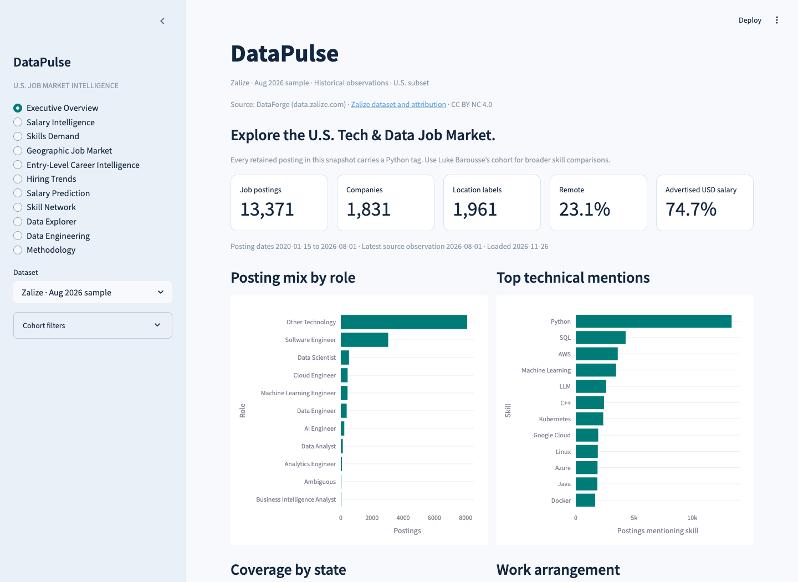
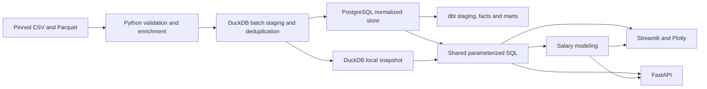

# DataPulse — U.S. Tech & Data Job Market Intelligence

DataPulse ingests and normalizes two historical sources of U.S. tech and data job postings. The dashboard and API support analysis by role, skill, geography, experience, work arrangement, and advertised pay.

| Verified snapshot | U.S. postings retained | Best use |
| --- | ---: | --- |
| Luke Barousse · 2023 | **204,273** | Dated posting patterns, role and skill mix, Connecticut and NYC comparisons |
| DataForge / Zalize · August 2026 Tier S | **13,371** | Advertised pay and salary estimation. All retained records carry a Python tag. |

The 2023 cohort includes 1,600 Connecticut and 7,959 NYC observations. SQL appears in 113,929 and Python in 106,066 of its postings. The published search process shapes these counts. The 2026 snapshot includes 9,990 comparable advertised USD midpoints, with a median of $184,500 in this salary-rich sample.

## Quick start

Run the full PostgreSQL, dbt, API and dashboard stack. Docker Compose downloads about 225 MiB of pinned data on the first run and preserves it in local Docker volumes. The services bind to loopback.

```bash
cp .env.example .env
docker compose up --build
```

Open [the dashboard](http://localhost:8501) or [interactive API documentation](http://localhost:8000/docs) after the setup service has finished. Use `docker compose logs -f pipeline` to follow progress, and `docker compose down` to stop the stack.

### Lightweight local demo

Python 3.11 or later on macOS or Linux. No GPU or API key is required. The default demo downloads the approximately 3.3 MiB Zalize extract and can run offline after setup.

```bash
python3 -m venv .venv
source .venv/bin/activate
make install
make demo
make dashboard
```

Run `make api` in another terminal with the environment active. For standalone 2023 analytics, run `make history`, then launch `DATAPULSE_DB_FILE=data/processed/luke.duckdb make dashboard`. The source-specific snapshots are separate in DuckDB and coexist as selectable cohorts in PostgreSQL.

## Dashboard



- **Executive Overview and Salary Intelligence** show cohort metrics, geography, remote signals and distributions for comparable advertised pay.
- **Skills Demand, Entry-Level Career Intelligence and Skill Network** compare skill mentions, early-career signals, role-specific pairs and graph communities.
- **Geographic Job Market and Hiring Trends** cover Connecticut, NYC, New York, Massachusetts, remote U.S. and nationwide cohorts. Trends use only eligible genuine posting dates.
- **Salary Prediction, Data Explorer, Data Engineering and Methodology** expose model estimates, paginated records, provenance, quality reports, pipeline history and interpretation.

See the [salary](screenshots/salary-intelligence.png), [skills](screenshots/skills-demand.png), [skill network](screenshots/skill-network.png) and [hiring trends](screenshots/hiring-trends.png) views.

## Architecture



The normalized schema separates sources, ingestion runs, employers, locations, titles, postings, salaries and the job-skill bridge. The pipeline reads bounded batches, keeps raw data separately, applies source-specific schema and quality rules, and bulk-loads the selected source transactionally into PostgreSQL. The DuckDB path provides an atomic single-source snapshot.

The dbt project contains eight staging views, one intermediate posting fact and seven marts for pay, skill demand, geography, remote work, experience, trends and co-occurrence. [Fifteen documented SQL queries](sql/analysis_queries.sql) cover windows, joins, percentiles, quality and coverage. Use `make transform` and `make docs` with the PostgreSQL environment configured. The Compose setup runs the dbt build automatically. The dashboard and API share a query layer so interactive cohorts behave consistently on either database.

## Data quality and source rights

| Metric | 2023 Luke source | 2026 Zalize S |
| --- | ---: | ---: |
| Rows read | 785,741 | 35,417 |
| Excluded outside U.S. or unknown | 579,449 | 22,046 |
| Duplicate rows | 2,019 | 0 |
| Retained U.S. observations | 204,273 | 13,371 |
| Known state | 85.7% | 69.9% |
| At least one tracked skill | 85.4% | 100.0% |
| Comparable advertised USD midpoint | 0.0% | 74.7% |

The 2023 file lacks currency. Its reported salary figures stay in the source units. DataForge supplies parsed salary ranges. The model and pay charts use eligible advertised USD values, with hourly and monthly figures normalized for eligible full-time postings. Posted dates, collection dates and ingestion dates are tracked independently.

Source credits go to [Luke Barousse](https://huggingface.co/datasets/lukebarousse/data_jobs) under the upstream card’s Apache-2.0 designation and to [DataForge (data.zalize.com)](https://data.zalize.com/datasets/tech-job-postings-salary-dataset) for the CC BY-NC 4.0 curated Zalize layer. The [MIT license](LICENSE) covers project code. The source records and serialized model stay local. Underlying job listings may carry separate rights. Commercial use of the Zalize data requires a separate rights review.

## Salary prediction

Target is the normalized advertised annual USD midpoint. Features are role family, experience signal, state and remote status. The pipeline splits by employer into 5,902 training, 1,656 validation and 2,432 test postings. Validation MAE selects Ridge from the median, Ridge, and random forest candidates.

| Held-out test metric | Ridge | Median baseline |
| --- | ---: | ---: |
| MAE | **$44,738** | $48,723 |
| RMSE | **$68,550** | $72,213 |
| R² | **0.078** | −0.023 |
| Median absolute error | **$31,029** | $35,800 |

The estimated interval has 86.3% empirical test coverage. Large errors and sample selection make this an exploratory baseline. Results by role, state, experience and salary band are in [model metrics](results/model_metrics.json). Role and skill extraction rules are implemented in [the rules module](src/datapulse/rules.py).

## API

| Method | Path | Result |
| --- | --- | --- |
| GET | `/health` | Datastore availability |
| GET | `/summary` | Counts, disclosure coverage and dates |
| GET | `/jobs` | Paginated posting projection |
| GET | `/skills` | Skill mentions and shares |
| GET | `/salary-statistics` | Advertised salary percentiles and sample sizes |
| GET | `/locations` | Known-state posting counts |
| GET | `/trends` | Observed monthly counts or coverage explanation |
| GET | `/data-quality` | Recent ingestion runs and coverage |
| POST | `/salary-predict` | Estimated midpoint and residual-based interval |

Use `?source=luke` or `?source=zalize` for a single cohort. Summary counts without a source filter describe rows loaded across publishers. `/jobs` accepts `limit` (1–200), `offset`, `title` and `skill`. OpenAPI JSON is at `/openapi.json`.

## Verification and deployment

```bash
make lint
make test
make validate
make sql
```

For a hosted deployment, start from the Docker image, provision PostgreSQL and run the ingestion, dbt and training setup as jobs. Check data rights and set service authentication before extending access outside the local machine. No hosted instance is configured.

Both datasets omit full descriptions and verified company size. Seniority usually reflects title evidence. Provider tags are mention signals. There is no scheduled live collection, and the Zalize cross-section cannot support monthly hiring trends. The 2023 counts reflect observed posting dates and changes in collection coverage.
