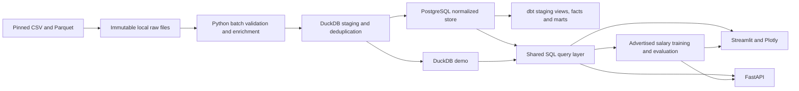
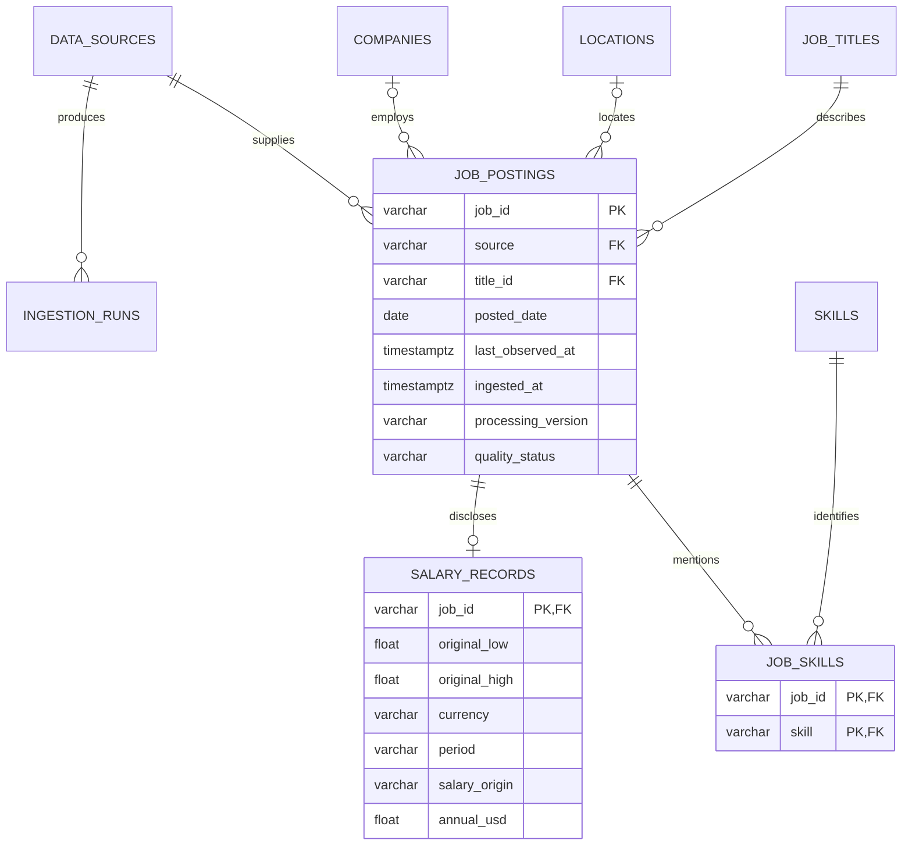

# Architecture and database schema

PostgreSQL is the primary deployment. DuckDB provides bounded-memory staging and a portable, single-source demo. Python reads CSV row streams or Arrow Parquet batches. SQL selects one record per source-scoped ID, preferring the latest observation and richer comparable information. Luke’s file lacks stable IDs, so its key hashes normalized title, employer, locality, posting day and schedule. This may collapse jobs with indistinguishable visible attributes. PostgreSQL COPY loads temporary tables, and the source replacement runs under a transaction-scoped advisory lock. Repeated PostgreSQL ingestion replaces the selected source while keeping the other cohort and prior successful ingestion runs. The DuckDB demo replaces its snapshot atomically and carries the latest run for that snapshot. Failed runs are logged to process output.

The dashboard and API use parameterized SQL over a one-row-per-posting view and the skill bridge, enabling identical interactive filters on either backend. dbt provides shared PostgreSQL marts for analysts and external BI consumers. A full rebuild is appropriate because each load replaces a pinned snapshot and the dataset fits on a local workstation. `make docs` generates a lineage catalog from PostgreSQL and `dbt docs serve --project-dir dbt --profiles-dir dbt` opens it locally.

The salary fact keeps original values, normalized bounds and the range midpoint separately. The pipeline annualizes monthly wages by 12 and full-time hourly wages by 2,080. Unsupported units, currencies and missing endpoints are visible in the quality rules. Historical FX conversion requires a verified dated table supplied by an operator. No FX table is bundled, so non-USD compensation remains in its original units. Prediction outputs are separate from salary facts.
